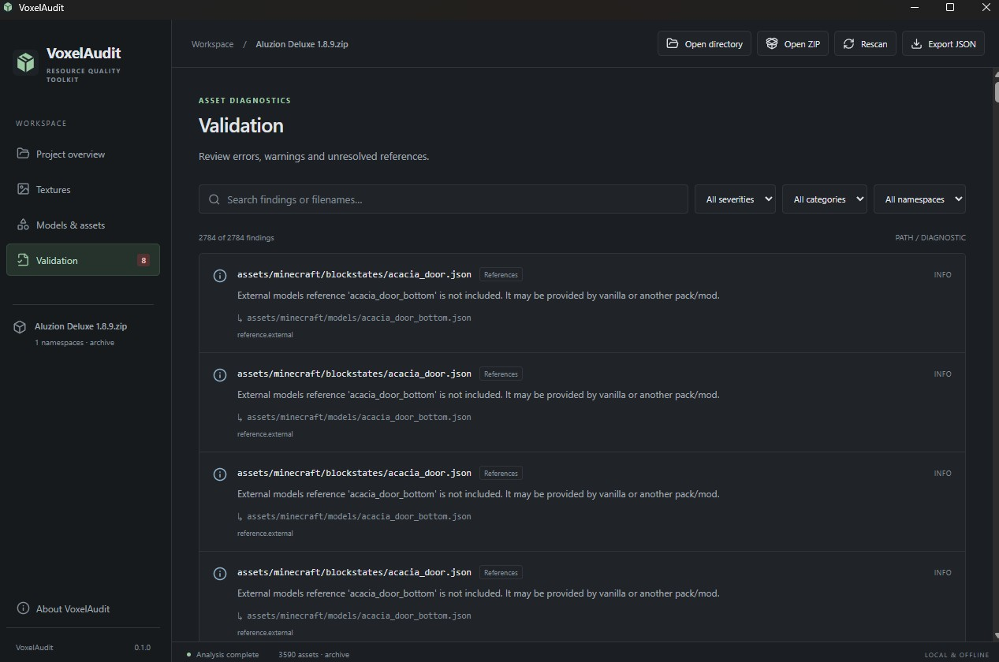
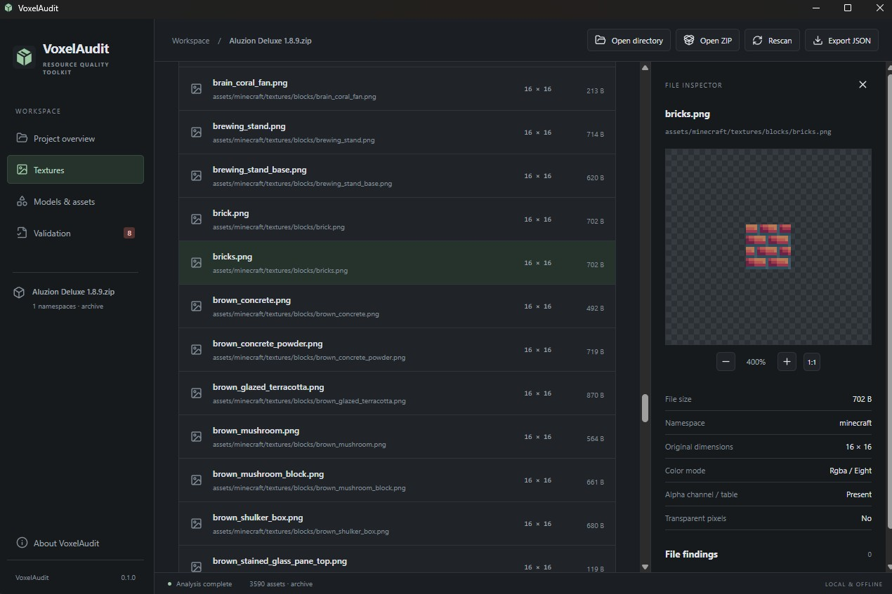

# VoxelAudit

Desktop inspector for Minecraft Java Edition resource packs and mod assets. Browse textures, check JSON files and find unresolved asset references without changing the pack.





## Features

- Open a folder or resource pack ZIP. Archives are read without extraction.
- Preview PNG textures with pixel zoom and a transparency checkerboard. Inspect dimensions, color mode and alpha information.
- Find JSON syntax errors and duplicate object keys, with line numbers or JSON pointer locations.
- Check model parents, textures, texture aliases, blockstates, legacy item overrides and sound-file references.
- Identify local inheritance and alias cycles.
- Filter files and findings by filename, namespace, category or severity.
- Cancel a scan, rescan after editing files and export the results as JSON.

Scans run locally and work offline. VoxelAudit does not upload files or collect telemetry. Reports are saved to a new file outside the inspected project.

## Open a pack

Select the folder containing `assets` and `pack.mcmeta`, or open a ZIP with those entries at its root. For a mod checkout, the folder is usually `src/main/resources`.

Use `fixtures/valid-pack` for a small working example. `fixtures/broken-pack` contains one JSON syntax error, three missing local references, an odd-sized texture and a vanilla model reference. These fixtures exercise the validator; they are not in-game compatibility tests.

## Development

Built with Tauri 2, React, TypeScript, Vite and Rust. The application identifier is `me.afaris.voxelaudit`.

On Windows, install:

- Node.js 24
- Stable Rust; the current lockfile has been tested with Rust 1.99.1
- Visual Studio 2022 Build Tools with **Desktop development with C++** and the Windows SDK
- Microsoft Edge WebView2 Runtime

```text
npm ci
npm run tauri dev
```

The launcher uses Rust from the environment. It also supports an optional local toolchain under `.toolchain/cargo` and `.toolchain/rustup`; that directory is excluded from Git.

`npm run dev` starts the frontend in a browser. Opening local packs requires the desktop application.

## Build

```text
npm run desktop:build
```

The Windows executable is written to `src-tauri/target/release/voxelaudit.exe`. The NSIS installer is written to `src-tauri/target/release/bundle/nsis/`.

Builds are unsigned. Follow the [release checklist](docs/releasing.md) before publishing an installer. WebView2 may need to be installed first on a clean or offline machine.

## Checks

```text
npm run format:check
npm run lint
npm test
npm run build
cargo fmt --manifest-path src-tauri/Cargo.toml --check
cargo test --locked --manifest-path src-tauri/Cargo.toml --no-default-features
cargo clippy --locked --manifest-path src-tauri/Cargo.toml --all-targets -- -D warnings
```

Tests cover JSON parsing, duplicate keys, resource identifiers, missing references, model inheritance, texture metadata, 8/16-bit alpha, archive paths, import limits, cancellation and report serialization. See the [verification record](docs/verification.md) for results and remaining platform checks.

GitHub Actions checks the frontend and native engine, builds the Windows application and provides a manually triggered installer build.

## Validation limits

An identifier without a namespace uses `minecraft`. Missing references in the current namespace produce warnings. References to vanilla or another namespace are informational when their files are absent, since another pack or mod may supply them.

PNG, JSON, `.mcmeta` and OGG files are indexed. PNG inspection reads the first frame. OGG files are used for reference checks; audio playback and audio validation are not included. Unknown JSON fields are accepted.

Custom model loaders, newer item definitions, texture atlases, shaders, animation timing and version-specific pack formats are not fully checked. Test the pack in Minecraft as well. Wrapper folders inside ZIPs are not automatically treated as the pack root.

Imports are limited to 50,000 entries, 16 MiB per supported file and 512 MiB of supported data. PNG decoding is limited to 64 MiB, and text previews to 1 MiB. Skipped imports are reported as an incomplete scan. Cancellation is checked between files and documents.

Windows is the primary target. Linux engine tests are configured in CI; macOS/Linux desktop builds and clean Windows 10/11 installation tests remain to be run.

## Project layout

- `src/`: React interface and native bridge
- `src-tauri/src/`: imports, parsing, validation and desktop commands
- `tests/`, `src-tauri/tests/`, `fixtures/`: tests and sample packs
- `scripts/`: build helpers and fixture asset generation
- `docs/`: architecture, verification, release instructions and an example report

See [architecture](docs/architecture.md) for the native command boundaries and scan lifecycle. Fixture PNGs and application icons can be rebuilt with `node scripts/generate-assets.mjs`.

## License

[MIT](LICENSE). The cube icon and fixture textures use the same license. Third-party dependencies retain their own licenses; frontend notices are included in [third-party notices](docs/third-party-notices.md).

VoxelAudit is not affiliated with Mojang or Microsoft.
